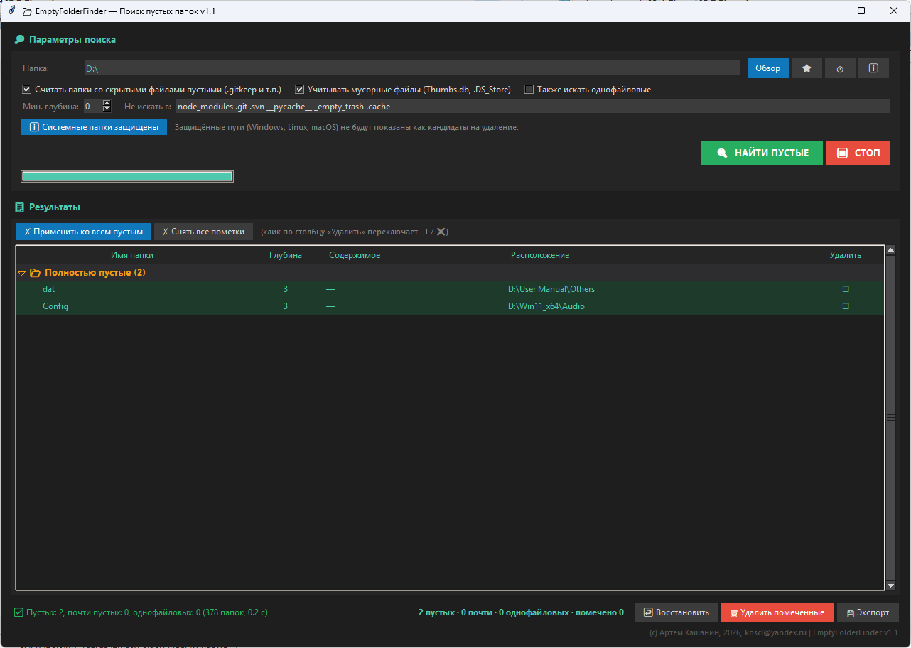

# EmptyFolderFinder — поиск пустых папок

**Версия:** 1.1


---


## 1. Что это

Утилита ищет пустые папки и помогает их удалить.
Работает локально, интернет не нужен. Ничего никуда не отправляет.

**Безопасность:**

- Удаление **ОБРАТИМОЕ** — папки перемещаются в `_empty_trash`, а не удаляются.
- Есть кнопка **ВОССТАНОВЛЕНИЯ** из корзины.
- **СИСТЕМНЫЕ ПАПКИ ЗАЩИЩЕНЫ** — `/usr`, `C:\Windows` и другие не показываются как кандидаты на удаление.

Три задачи, которые решает утилита:

### Найти пустые папки

После распаковки архивов, удаления проектов, чисток — часто остаются пустые папки, которые занимают место в структуре и мешают навигации.

### Найти «почти пустые»

Папки, где лежит только `.DS_Store`, `Thumbs.db`, `desktop.ini` — мусорные файлы, создаваемые системой. Формально папка не пустая, но фактически — да.

### Удалить безопасно

Папки перемещаются в `_empty_trash` **рядом с корнем поиска**, а не удаляются безвозвратно. Если удалили лишнее — восстанавливаете одной кнопкой.



---

## 2. Честно о возможностях

Три вещи, которые важно понимать сразу.

### 1. Удаление ОБРАТИМОЕ

Папки перемещаются в `_empty_trash` (не в системную корзину). Это сделано специально — без зависимостей, работает везде.

**ВОССТАНОВЛЕНИЕ** — кнопка «↩ Восстановить» читает `_empty_trash/restore.json` и создаёт папки обратно. Содержимое тоже возвращается (папка перемещается целиком).

### 2. Некоторые пустые папки — это СТРУКТУРА ПРИЛОЖЕНИЙ

Многие программы создают пустые папки **намеренно**:

- **Tor Browser** — `profile.default/storage/...`, `bitmaps`, `Startup`, `entries`, `events`
- **Wine** — `drive_c/users/.../AppData/...`
- **Firefox / Chrome** — `.mozilla`, `.config/google-chrome/...`
- **IDE** — `.vscode/extensions/.obsolete`

Если их удалить — приложение может:

- Пересоздать их (толку ноль)
- Сломаться или потерять настройки

Поэтому утилита по умолчанию исключает известные профильные папки (см. [раздел 10](#10-что-не-надо-удалять)).

### 3. «Пустая» — РЕКУРСИВНО ПУСТАЯ

Папка считается пустой, если внутри **нет файлов** и **нет непустых подпапок**. То есть `archive/2024/` внутри `archive/` — обе пустые, если в `2024/` ничего нет.

Это правильно: удалив `2024/`, `archive/` тоже становится пустой.

---

## 3. Быстрый старт

1. Запустите утилиту.
2. Выберите папку: кнопка **«Обзор»** или введите путь + `Enter`.
3. Настройте опции (по умолчанию — разумные).
4. Нажмите **«🔍 НАЙТИ ПУСТЫЕ»**.
5. Просмотрите результаты — три группы.
6. Пометьте нужные (клик по столбцу «Удалить» → ❌) → **«🗑 Удалить помеченные»** → подтвердите.
7. Папки уедут в `_empty_trash`. Восстановить → кнопка **«↩ Восстановить»**.

---

## 4. Параметры поиска

### Папка

Где искать. Кнопка «Обзор» или ручной ввод + `Enter`.
Закладки (⭐) и история (🕐) — как в остальных утилитах семейства.

### Опции

- ☐ **Считать папки со скрытыми файлами пустыми**
  Выкл по умолчанию. Папка с `.gitkeep` считается **НЕ** пустой (там файл). Если включить — `.gitkeep`, `.DS_Store` и другие скрытые файлы не мешают считать папку пустой.

- ☑ **Учитывать мусорные файлы**
  Вкл по умолчанию. Папка с `Thumbs.db` / `.DS_Store` / `desktop.ini` попадает в «почти пустые».

- ☐ **Также искать однофайловые**
  Выкл по умолчанию. Показывать папки с ровно одним файлом (без подпапок).

### Мин. глубина

Не показывать пустые папки **ближе** к корню, чем N уровней.
Полезно, если корневые папки нужны для структуры.

- `0` — показывать всё
- `1` — не показывать папки в корне поиска
- `2` — не показывать на первом уровне вложенности

### Не искать в

Список папок-исключений, через пробел или запятую.
По умолчанию:

```
node_modules .git .svn __pycache__ _empty_trash .cache
```

Дополнительно можно добавить профильные папки (см. [раздел 10](#10-что-не-надо-удалять)).

### Защита системных путей

Кнопка **«ℹ Системные папки защищены»** — показывает полный список путей, которые **никогда** не отображаются как кандидаты на удаление.

---

## 5. Три категории

Утилита разделяет результаты на три группы — по цвету и по «риску удаления».

### 📂 Полностью пустые (зелёные)

Папка **НЕ** содержит ни файлов, ни папок. Идеальный кандидат на удаление.

```
projects/
└── old_project/          ← пусто
```

### ⚠️ Почти пустые (жёлтые)

Папка содержит только **мусорные файлы**: `.DS_Store`, `Thumbs.db`, `desktop.ini`, `.directory`, `~$*.tmp` (временные Word / Excel).

Формально не пустая. Но если эти файлы — мусор (созданы системой), папку можно удалять.

```
downloads/
└── Инструкция/           ← только .DS_Store внутри
```

Утилита **НЕ** удаляет их автоматически — в колонке «Содержимое» видно, что там лежит. Пользователь сам решает.

### 📄 Однофайловые (оранжевые, опционально)

Папка содержит **ровно один файл**, ни одной подпапки.

Иногда это «случайно созданная папка вокруг файла» (например, распаковка создала `file.txt/` рядом с `file.txt`). Но чаще — нужная структура.

По умолчанию выключено — включается галочкой.

---

## 6. Результаты

```
📂 Полностью пустые (2043)
   364722291wieabcExolt-eengsairo.files  13  —  /.../profile
   3870112724rsegmnoitter-es.files       13  —  /.../profile
   ВСЕ ПРИЛОЖЕНИЯ К ОМУ 2016-2020        13  —  /Может_быть/...
   ...

⚠️ Почти пустые — только мусор (9)
   Инструкция                            5   .DS_Store  /downloads
   ...

📄 Однофайловые (0)
   ...
```

### Колонки

| Колонка | Что показывает |
|---|---|
| **Имя папки** | имя папки |
| **Глубина** | на сколько уровней вложена от корня |
| **Содержимое** | для «почти пустых» — список мусорных файлов; для «однофайловых» — имя файла; для «пустых» — «—» |
| **Расположение** | полный путь к родительской папке |
| **Удалить** | ☐ / ❌ (клик переключает) |

### Цвета

- **Зелёный** — полностью пустые
- **Жёлтый** — почти пустые
- **Оранжевый** — однофайловые
- **Красный** — помечено на удаление (❌)

В статусе внизу:

```
✅ Пустых: 2043, почти пустых: 9, однофайловых: 0
   (13578 папок, 32.4 с)
```

---

## 7. Удаление папок

### Как удаляется

1. Пометьте папки: клик по столбцу «Удалить» (`☐` → `❌`).
   Или **«✗ Применить ко всем пустым»** — расставит `❌` на все «Полностью пустые».
2. Нажмите **«🗑 Удалить помеченные»**.
3. Подтвердите.
4. Папки перемещаются в `_empty_trash` **рядом с корнем поиска**.

> Удаление работает **ПО ПОМЕТКАМ**, а не по выделению.
> «Снять все пометки» — сбросить `❌`.

### Структура

```
/home/user/projects/          ← корень поиска
├── projects/                 ← рабочие папки
│   └── old_project/          ← пометили и удалили
└── _empty_trash/             ← корзина
    ├── old_project/          ← перемещённая (целиком)
    └── restore.json          ← манифест
```

### Что можно, что нельзя

- ✅ **Можно**: удалять папки из группы «Полностью пустые».
- ✅ **Можно**: «Почти пустые» — но сначала убедитесь, что внутри действительно только мусор.
- ❌ **Нельзя автоматически**: «Однофайловые» — там **есть файл**, который вы можете потерять. Удалите вручную, если точно не нужен.

---

## 8. Восстановление

Кнопка **«↩ Восстановить»** внизу:

- Читает `_empty_trash/restore.json`.
- Перемещает папки обратно на исходные места (вместе с содержимым).
- Показывает: «Восстановлено: N, Ошибок: M».

Восстановление работает даже после перезапуска утилиты — манифест на диске.

Если целевая папка уже существует (например, создана вручную) — она **НЕ** перезаписывается, остаётся в манифесте.

---

## 9. Защищённые системные пути

Эти пути **никогда** не отображаются как пустые папки — утилита их игнорирует.

### Linux

```
/bin  /sbin  /lib  /lib32  /lib64  /libx32
/usr  /etc   /boot /dev    /proc   /sys
/var/lib  /var/cache  /var/spool  /var/log
/lost+found  /run  /root
```

### Windows

```
C:\Windows
C:\Program Files
C:\Program Files (x86)
C:\ProgramData\Microsoft
C:\ProgramData\Package Cache
C:\Recovery
C:\System Volume Information
C:\$Recycle.Bin
C:\inetpub          (появилась в обновлении KB5055526)
C:\PerfLogs
```

### macOS

```
/System  /Library  /bin  /sbin  /usr
/private /var      /etc  /dev   /Volumes
/Applications      /cores
```

Проверка работает **на любой глубине** — если путь **внутри** защищённого, он тоже защищён.

```
/usr/local/share/пусто        → защищён (внутри /usr)
C:\Program Files\MyApp\empty  → защищён
```

---

## 10. Что НЕ надо удалять

Многие пустые папки — **структура приложений**, а не мусор.
Их лучше исключить в поле «Не искать в».

### Tor Browser

```
tor-browser  profile.default  storage  bitmaps  Startup
entries  events  pending_pings  doomed  Caches  Cache
```

### Wine

```
wine  drive_c  users  AppData  Roaming  Local
```

### Браузеры и IDE

```
.mozilla  .config/google-chrome  Chromium  Mozilla
.vscode  .vscode-server  .idea  .pytest_cache  .mypy_cache
```

### Что предложить

Добавьте в поле «Не искать в» через пробел:

```
tor-browser wine AppData .mozilla Chromium Chrome .vscode .idea
```

После этого «пустых» станет значительно меньше — останутся только настоящие.

**Или** можно не исключать, но внимательно смотреть пути перед удалением. Если путь содержит `tor-browser`, `AppData`, `.config` — скорее всего, это структура приложения, не удаляйте.

---

## 11. Горячие клавиши

| Клавиша | Действие |
|---|---|
| `Enter` в поле «Папка» | Перейти к введённому пути |
| `Ctrl+A` | Выделить всё (все группы) |
| `Ctrl+C` | Копировать пути выделенных папок |
| `Пробел` | Переключить пометку у выделенных |
| Двойной клик по папке | Открыть в файловом менеджере |
| ПКМ по строке | Контекстное меню |

---

## 12. Контекстное меню (ПКМ)

Правый клик по папке:

### 📁 Открыть в файловом менеджере

Открыть папку системным способом.
Windows: Проводник, macOS: Finder, Linux: Nautilus / Dolphin / etc.

### ❌ Пометить: удалить

Поставить `❌` на выделенные.

### ☐ Пометить: оставить

Снять `❌` с выделенных.

### 📋 Копировать путь

Полный путь к папке.

### 📋 Копировать имя

Только имя папки.

---

## 13. Экспорт результатов

Кнопка **«💾 Экспорт»**. Форматы:

| Формат | Что внутри |
|---|---|
| **CSV** | Таблица: категория, путь, имя, глубина, содержимое, пометка. Разделитель `;`, UTF-8 с BOM |
| **JSON** | Структурированный: `root`, `created`, три группы с полными данными + флаг `marked` |
| **HTML** | Цветная страница с тремя секциями: пустые / почти пустые / однофайловые |
| **TXT** | Простой список путей по группам с `☐` / `❌` |

Экспорт полезен перед массовым удалением — сохраните, если удалите лишнее, будет список.

---

## 14. История и закладки

- Кнопка **⭐** — добавить текущую папку в закладки.
- Кнопка **🕐** — открыть окно «История и закладки».

Как в остальных утилитах семейства.

---

## 15. Настройки

Настройки сохраняются автоматически при выходе.

| ОС | Путь |
|---|---|
| **Windows** | `C:\Users\<Имя>\.emptyfolderfinder_settings.json` |
| **Linux** | `/home/<имя>/.emptyfolderfinder_settings.json` |
| **macOS** | `/Users/<имя>/.emptyfolderfinder_settings.json` |

### Что сохраняется

- Последняя папка поиска.
- Закладки, история.
- Все галочки (скрытые, мусорные, однофайловые).
- Минимальная глубина.
- Список исключений.

Чтобы сбросить настройки — удалите файл.

---

## 16. Требования

**ОС:** Windows 7 и новее, Linux, macOS.

Для базовой работы — ничего дополнительно.

Для открытия папок в файловом менеджере:

- **Windows / macOS** — работает из коробки.
- **Linux** — нужен `xdg-open` (пакет `xdg-utils`), обычно уже установлен.

Если утилита пишет «Не удалось открыть» — установите `xdg-utils`:

```bash
sudo apt-get install xdg-utils
```

(или аналог для вашего дистрибутива)

---

## 17. Частые вопросы

### В: Найдено 2043 пустых папки — это нормально?

**О:** Скорее всего, большинство — **внутри профилей приложений** (Tor Browser, Wine, браузеры, IDE). Эти папки — часть структуры, они пересоздаются при запуске. **Проверьте пути** перед удалением. Если путь содержит `tor-browser`, `wine`, `AppData`, `.config`, `.mozilla` — **не удаляйте**.

### В: Что делать с «почти пустыми»?

**О:** Посмотрите, какие файлы внутри (`.DS_Store`, `Thumbs.db` — мусор). Если это мусор — пометьте и удалите. Если что-то важное — оставьте. Утилита **НЕ** удаляет их автоматически.

### В: Удалённые папки можно вернуть?

**О:** Да. Кнопка **«↩ Восстановить»** внизу — возвращает папки вместе с содержимым из `_empty_trash/restore.json`. Если целевая папка уже существует — не перезаписывает, оставляет в манифесте.

### В: Где хранится корзина?

**О:** В `<корень_поиска>/_empty_trash/`. Там же `restore.json` — манифест с путями удалённых папок.

### В: Почему защищённые пути не удаляются?

**О:** Это системные директории. Их удаление может сломать ОС. Утилита **никогда** не показывает их как кандидатов.

### В: Я хочу удалить что-то в защищённой папке — можно?

**О:** Нет. Утилита это делать **не будет**. Если очень надо — вручную в файловом менеджере, но помните о рисках.

### В: Что означает `~$*.tmp` в списке мусорных файлов?

**О:** Временные файлы Word / Excel (`~$документ.docx`). Они создаются при открытии документа и удаляются при закрытии. Если остались — приложение падало, и это мусор.

### В: Файл `.gitkeep` в папке — папка пустая?

**О:** Зависит от галочки:

- **«Считать папки со скрытыми файлами пустыми» ВЫКЛ** (по умолчанию) — папка с `.gitkeep` считается **НЕ** пустой (там файл).
- **ВКЛ** — `.gitkeep` и другие скрытые файлы не мешают, папка считается пустой.

### В: Почему при включении «Считать папки со скрытыми файлами пустыми» результатов становится БОЛЬШЕ?

**О:** Потому что скрытые файлы (`.gitkeep`, `.DS_Store`) перестают считаться содержимым. Папка, где был только `.gitkeep`, становится «пустой» и попадает в результаты. Это ожидаемое поведение.

### В: Как экспортировать список перед удалением?

**О:** Кнопка **«💾 Экспорт»** → CSV / JSON / HTML / TXT. Сохраните — потом сможете свериться, что удаляли.

### В: Утилита удаляет по одной или всё сразу?

**О:** По пометкам. Пометьте несколько (клик по столбцу «Удалить», или **«✗ Применить ко всем пустым»**) → **«🗑 Удалить помеченные»** → подтверждение → все уедут в `_empty_trash`.

### В: Что если папка не пуста, но я её пометил?

**О:** Утилита **проверит** перед удалением. Если внутри что-то появилось (например, другой процесс создал файл) — папка будет **пропущена**, в отчёте будет ошибка.

### В: Где хранятся настройки?

**О:** См. [раздел 15](#15-настройки).

### В: Утилита отправляет данные в интернет?

**О:** Нет. Всё работает локально.

### В: При запуске появляется предупреждение антивируса.

**О:** Некоторые антивирусы настороженно относятся к новым исполняемым файлам без цифровой подписи. Это нормально для небольших утилит. Добавьте файл в исключения или запустите «Разрешить».

---

**EmptyFolderFinder v1.1** ·

Разработчик: AKSoft

Email: artemsoft@yahoo.com

Telegram: @avhelpnew

GitHub: https://github.com/artemsoft2025/
